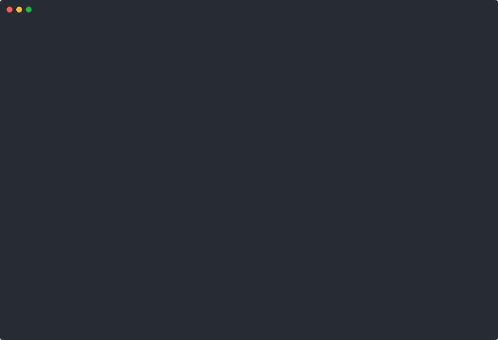

# OpenAPI Mocker

A self-contained mock server written in Go. Give it an OpenAPI, GraphQL, MCP
or gRPC (`.proto`) contract and it serves a working mock of that API, with a
built-in web UI, mock data written by hand or generated by an LLM, request
logging, contract-drift detection, load testing and code generation for Go,
TypeScript, Python, Java, Rust and C#. It builds into a single binary or a
single Docker image and runs on a desktop, in Docker, in Kubernetes and
headless in CI.

**Documentation: <https://eisenmann.github.io/openapi-mocker/>** (the sources
are in [`docs/`](docs/index.md)).

## Quick start

Install the binary (see [Installation](docs/installation.md) for all options):

```bash
brew install Eisenmann/tap/openapi-mocker                                  # macOS, Linux
scoop bucket add eisenmann https://github.com/Eisenmann/scoop-bucket && scoop install openapi-mocker   # Windows
go install github.com/Eisenmann/openapi-mocker/cmd/openapi-mocker@latest   # Go 1.26+
```

Then start the built-in Petstore, with no file and no UI (stop it with Ctrl+C):

```bash
openapi-mocker serve --demo
curl localhost:8080/pets
```



Serve your own contract file the same way, for example in CI. Nothing is left
behind:

```bash
openapi-mocker serve examples/petstore.yaml
curl http://localhost:8080/pets
```

For the full server with the web UI, run `openapi-mocker` with no arguments or
use Docker:

```bash
docker run -p 8080:8080 -v mocker-data:/data ghcr.io/eisenmann/openapi-mocker:latest
# UI: http://localhost:8080
```

More options (Compose, Kubernetes, the CI image):
[Quick start](docs/quickstart.md) and [Deployment](docs/deployment.md).
Start time, memory and throughput against WireMock, Prism and Mockoon CLI:
[Benchmark](docs/benchmark.md).

## What is inside

- **Contracts:** OpenAPI 3.x (3.1 and Swagger 2 are converted), GraphQL SDL, MCP
  manifests and `.proto` files, with versioning, diff and rollback.
  [Guide](docs/contracts.md)
- **Mock behaviour:** scenarios, request matching, response templating,
  stateful mocks, fault injection and request validation.
  [Guide](docs/mock-behavior.md)
- **Streaming and gRPC:** Server-Sent Events, WebSocket, GraphQL subscriptions
  and gRPC with reflection. [Guide](docs/streaming-grpc.md)
- **Record & replay and drift:** proxy a real upstream, record responses,
  report contract drift and breaking changes, run `diff` in CI.
  [Guide](docs/proxy-and-drift.md)
- **Auth and access:** auth simulation, per-project tokens, share links and an
  audit log. [Guide](docs/auth-and-access.md)
- **Observability and tests:** live request log, metrics, log shipping and a
  `verify` API so tests can assert what their service sent.
  [Guide](docs/observability.md)
- **Import and export:** Postman, Insomnia, HAR, OpenAPI and bundles.
  [Guide](docs/import-export.md)
- **Load testing:** plan files, open and closed models, thresholds and
  HTML/JSON/JUnit/CSV reports. [Guide](docs/load-testing.md)
- **Code generation:** server skeletons and clients for six languages.
  [Guide](docs/code-generation.md)

The full [REST API](docs/rest-api.md) is available for everything the UI does.
Read the [known limitations](docs/limitations.md) before a production setup;
in particular, the JSON-file store is meant for a single replica.

## Configuration

The server is configured with environment variables, for example `PORT`
(default 8080), `DATA_DIR` (default `./data`), `ADMIN_TOKEN`, `GRPC_PORT`,
`LOG_MODE` and `LOAD_MAX_RPS`. Each one is described on the page of the
feature it belongs to.

## Development

```bash
go test ./...
golangci-lint run
```

The code follows a clean-architecture layout: `internal/domain` and
`internal/usecase` know nothing about HTTP, files or LLM providers, which live
in `internal/adapter/*`; `cmd/openapi-mocker` is the only place where they are wired
together. To preview the docs locally:
`pip install mkdocs-material && mkdocs serve`.

## License

MIT, see [LICENSE](LICENSE).
