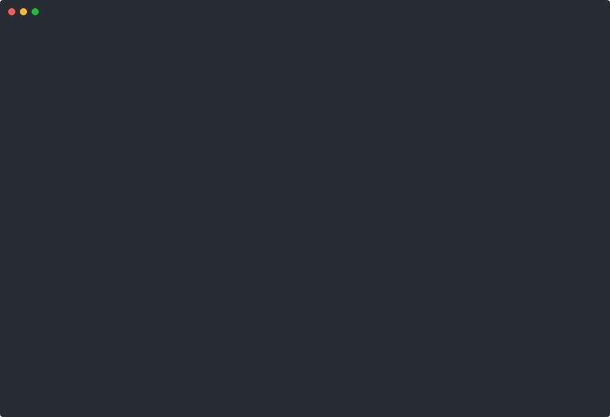

# OpenAPI Mocker

OpenAPI Mocker is a self-contained mock server written in Go. Give it an
OpenAPI, GraphQL, MCP or gRPC (`.proto`) contract and it serves a working mock
of that API, with a web UI, request logging, drift detection, load testing and
code generation. It builds into a single binary or a single Docker image and
runs on a desktop, in Docker, in Kubernetes and headless in CI.

## Try it in a minute



Start the built-in Petstore, with no file and no UI:

```bash
openapi-mocker serve --demo
curl localhost:8080/pets
```

Serve your own contract file the same way, and nothing is left behind:

```bash
openapi-mocker serve spec.yaml
curl http://localhost:8080/users/1
```

For the full server with the web UI, run the Docker image:

```bash
docker run -p 8080:8080 -v mocker-data:/data ghcr.io/eisenmann/openapi-mocker:latest
# UI: http://localhost:8080
```

See [Installation](installation.md) for Homebrew, Scoop, `go install`, release
archives and Docker, and the [quick start](quickstart.md) for the desktop,
Docker and CI options. For start time, memory and throughput against WireMock,
Prism and Mockoon CLI, see the [benchmark](benchmark.md).

## What it does

| Area | What you get | Page |
|---|---|---|
| Contracts | OpenAPI 3.x (3.1 and Swagger 2 converted), GraphQL SDL, MCP manifests, `.proto` files; versioning, diff, rollback; LLM-assisted generation | [Contracts and mock data](contracts.md) |
| Mock behaviour | scenarios, request matching, templating, stateful mocks, fault injection, request validation | [Mock behaviour](mock-behavior.md) |
| Streaming | Server-Sent Events, WebSocket, GraphQL subscriptions, gRPC with reflection | [Streaming and gRPC](streaming-grpc.md) |
| Proxy and drift | record and replay against a real upstream, contract-drift reports, breaking-change alerts, a CI `diff` command | [Record & replay, drift](proxy-and-drift.md) |
| Security | auth simulation (API key, bearer, basic, OAuth2), per-project tokens, share links, audit log | [Auth and access](auth-and-access.md) |
| Observability | live request log, hit counts, Prometheus metrics, log shipping, test assertions (`verify`) | [Observability](observability.md) |
| Import / export | Postman, Insomnia, HAR, OpenAPI, Swagger, bundles | [Import and export](import-export.md) |
| Load testing | plans, open and closed models, thresholds, HTML/JSON/JUnit/CSV reports | [Load testing](load-testing.md) |
| Code generation | server skeletons and clients for Go, TypeScript, Python, Java, Rust and C# | [Code generation](code-generation.md) |
| Operations | Homebrew, Scoop, `go install`, Docker, Kubernetes, release binaries | [Installation](installation.md), [Deployment](deployment.md) |

Everything the UI does is also available over the [REST API](rest-api.md).
Read [Known limitations](limitations.md) before you plan a production setup.
The optional [usage ping](privacy.md) is off unless you turn it on.

## The web UI

The UI is an embedded single-page app (nothing to deploy separately). It lists
projects, edits contracts and mock rules, shows the live request log, and lets
you send a request to the mock from the browser (**Try it**) without Postman
or curl.
